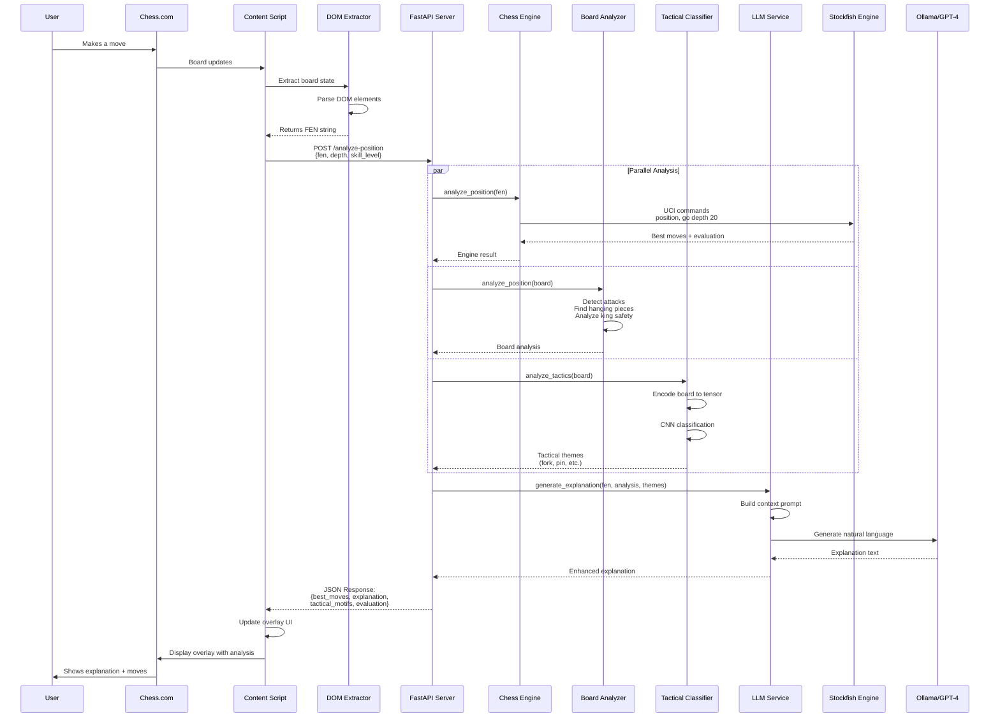
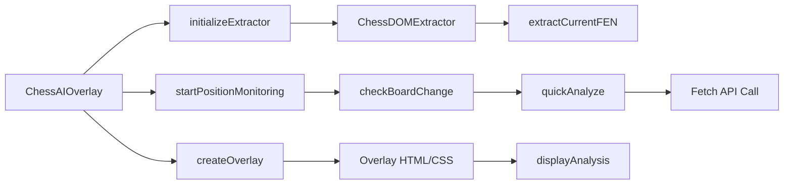
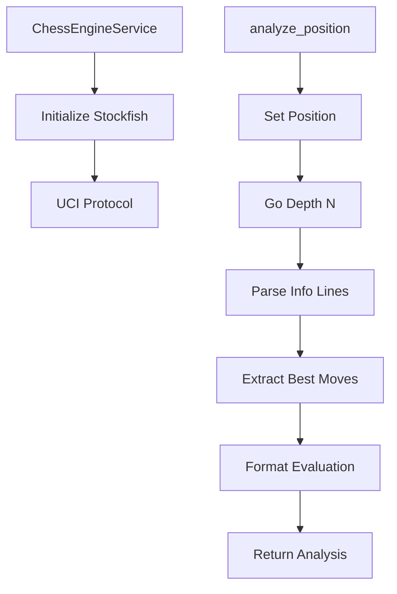
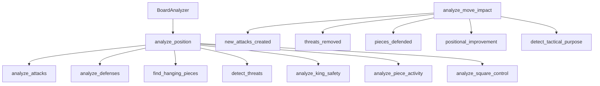
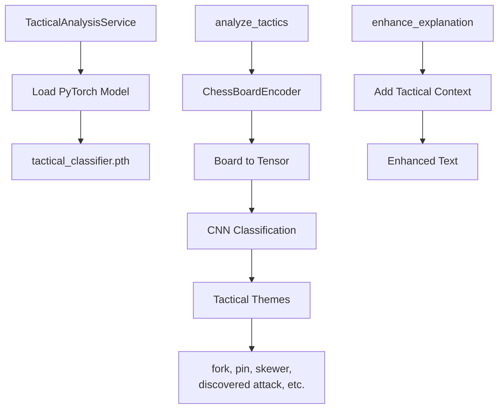
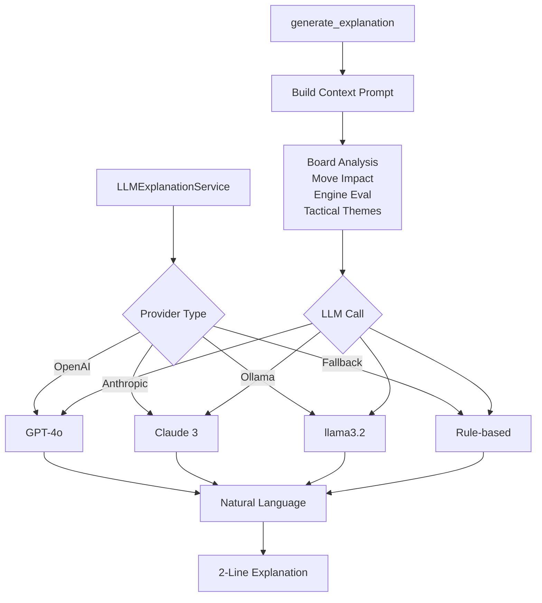
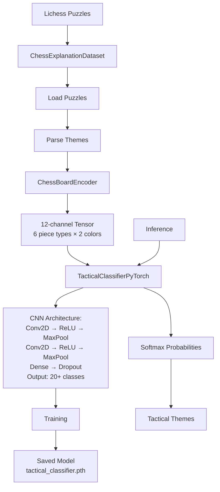
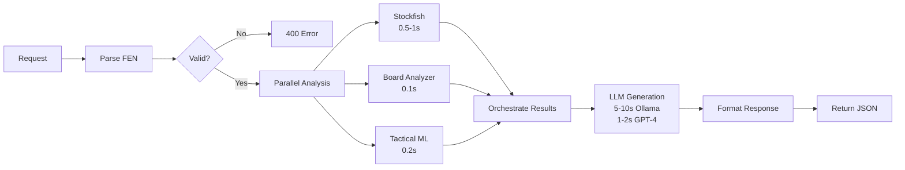
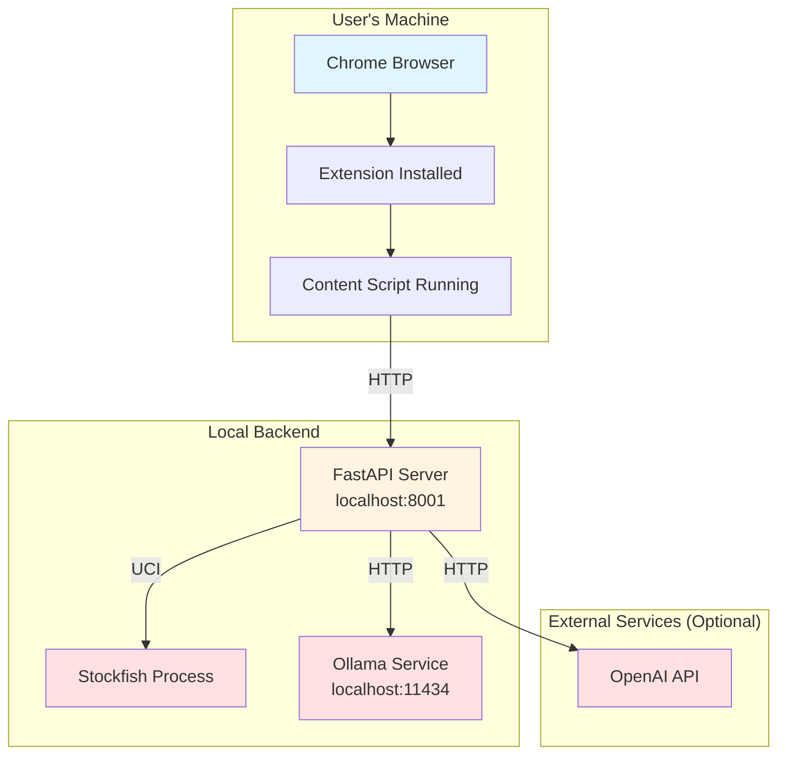

# Explainable Chess AI - Architecture

This document provides a comprehensive overview of the system architecture and data flow.

## System Architecture

```mermaid
graph TB
    subgraph "Browser Extension (Frontend)"
        A[Chess.com Page] --> B[Content Script<br/>content-script.js]
        B --> C[DOM Extractor<br/>dom-extractors.js]
        C --> D[FEN Parser]
        D --> E[Overlay UI<br/>ExplanationOverlay.js]
        F[Background Script<br/>background.js] -.-> B
        G[Popup UI<br/>popup.js] -.-> B
    end

    subgraph "FastAPI Backend Server"
        H[API Endpoints<br/>main.py]
        H --> I[/analyze-position]
        H --> J[/explain-move]
        H --> K[/health]
    end

    subgraph "Core Services Layer"
        L[Chess Engine Service<br/>chess_engine.py]
        M[Board Analyzer<br/>board_analyzer.py]
        N[Tactical Analysis Service<br/>tactical_analysis.py]
        O[LLM Explanation Service<br/>llm_explanation.py]
        P[NLP Explanation<br/>nlp_explanation.py]
    end

    subgraph "ML Components"
        Q[Tactical Classifier<br/>PyTorch CNN]
        R[Board Encoder<br/>data_preprocessing.py]
        S[Chess Dataset<br/>chess_explanation_dataset.py]
        T[Trained Model<br/>tactical_classifier.pth]
    end

    subgraph "External Services"
        U[Stockfish Engine]
        V[Ollama API<br/>llama3.2]
        W[OpenAI API<br/>GPT-4]
    end

    subgraph "Data Storage"
        X[(Lichess Puzzles<br/>lichess_puzzles.json)]
        Y[(Theme Statistics<br/>theme_statistics.json)]
        Z[(Training Data<br/>models/training_data)]
    end

    %% Frontend to Backend
    E -->|HTTP POST| H
    B -->|Board Position<br/>FEN String| H

    %% API to Services
    I --> L
    I --> M
    I --> N
    I --> O
    J --> O
    J --> M

    %% Services Orchestration
    L -->|Position Evaluation| M
    M -->|Board Analysis| O
    N -->|Tactical Themes| O
    L -->|Engine Analysis| O

    %% ML Data Flow
    N --> Q
    Q --> R
    R --> S
    T -.-> Q
    Z -.-> S

    %% External Services
    L -->|UCI Protocol| U
    O -->|LLM Request| V
    O -->|LLM Request| W
    X -.-> S
    Y -.-> N

    %% Response Flow
    O -->|Explanation Text| I
    I -->|JSON Response| E
    E -->|Display| A

    style A fill:#e1f5ff
    style H fill:#fff4e1
    style L fill:#f0e1ff
    style M fill:#f0e1ff
    style N fill:#f0e1ff
    style O fill:#f0e1ff
    style Q fill:#e1ffe1
    style U fill:#ffe1e1
    style V fill:#ffe1e1
    style W fill:#ffe1e1
```

## Detailed Data Flow



## Component Details

### 1. Frontend (Chrome Extension)

**File: `frontend/content-scripts/content-script.js`**



**Responsibilities:**
- Detect chess board on Chess.com
- Extract FEN position from DOM
- Monitor board changes every 5 seconds
- Display analysis overlay
- Handle user interactions

### 2. Backend API

**File: `backend/app/main.py`**

```mermaid
graph TB
    A[FastAPI App] --> B[CORS Middleware]
    B --> C[Service Initialization]
    
    C --> D[ChessEngineService]
    C --> E[ExplanationEngine]
    C --> F[MLService]
    
    G[/analyze-position] --> H[Validate FEN]
    H --> I[Engine Analysis]
    H --> J[Board Analysis]
    H --> K[ML Insights]
    
    I --> L[Compile Response]
    J --> L
    K --> L
    
    L --> M[AnalysisResponse]
```

**Key Endpoints:**
- `GET /` - Root endpoint
- `GET /health` - Health check
- `POST /analyze-position` - Main analysis endpoint
- `POST /explain-move` - Explain specific move

### 3. Chess Engine Service

**File: `backend/app/services/chess_engine.py`**



**Responsibilities:**
- Initialize Stockfish engine
- Communicate via UCI protocol
- Analyze positions at depth 20
- Extract best moves with evaluations
- Parse centipawn scores

### 4. Board Analyzer

**File: `backend/app/services/board_analyzer.py`**



**Analysis Components:**
1. **Attacks**: Which pieces attack which squares
2. **Defenses**: Which pieces defend which squares
3. **Hanging Pieces**: Undefended pieces under attack
4. **Threats**: Check, hanging pieces, tactical shots
5. **King Safety**: Castling status, enemy attacks near king
6. **Piece Activity**: Mobility count for all pieces
7. **Square Control**: Control of central squares (d4, d5, e4, e5)

### 5. Tactical Analysis Service

**File: `backend/app/services/tactical_analysis.py`**



**Detected Themes (20+):**
- Fork
- Pin
- Skewer
- Discovered Attack
- Double Attack
- Mate in 1/2/3
- Back Rank Mate
- Hanging Piece
- Trapped Piece
- Sacrifice
- Deflection
- Attraction
- Clearance
- X-Ray Attack

### 6. LLM Explanation Service

**File: `backend/app/services/llm_explanation.py`**



**LLM Prompt Structure:**
```
You are a chess coach. Explain why {move} is the best move 
in this {position_type} position.

Move: {move_san} {action}
Evaluation: {eval_text}
Tactical themes: {themes}

Explain in EXACTLY 2 lines. Be concise.
```

### 7. ML Pipeline

**Files: `backend/app/ml/`**



**CNN Architecture:**
```python
Input: (12, 8, 8) tensor
  ↓
Conv2D(12, 64, kernel=3) + ReLU + MaxPool(2)
  ↓
Conv2D(64, 128, kernel=3) + ReLU + MaxPool(2)
  ↓
Flatten
  ↓
Dense(128) + ReLU + Dropout(0.5)
  ↓
Dense(num_themes) + Softmax
  ↓
Output: Theme probabilities
```

## Request/Response Flow

### Request Format

```json
{
  "fen": "rnbqkbnr/pppppppp/8/8/4P3/8/PPPP1PPP/RNBQKBNR b KQkq e3 0 1",
  "depth": 20,
  "user_skill_level": "intermediate",
  "explanation_type": "comprehensive"
}
```

### Internal Processing



### Response Format

```json
{
  "fen": "rnbqkbnr/pppppppp/8/8/4P3/8/PPPP1PPP/RNBQKBNR b KQkq e3 0 1",
  "best_moves": [
    {
      "move": "e7e5",
      "san": "e5",
      "score": {
        "type": "cp",
        "value": -34,
        "display": "-0.34"
      }
    }
  ],
  "explanations": [
    {
      "explanation": "e5 controls the center and equalizes the position. This move opens lines for the bishop and queen while challenging White's central pawn.",
      "skill_level": "intermediate"
    }
  ],
  "position_evaluation": {
    "type": "cp",
    "value": -34,
    "display": "-0.34"
  },
  "learning_insights": [
    "Tactical themes: center_control, development",
    "Position type: opening",
    "Key concept: Fighting for the center is critical in the opening"
  ]
}
```

## Technology Stack

### Frontend
- **JavaScript** (ES6+)
- **Chrome Extension API** (Manifest V3)
- **DOM Manipulation** (Vanilla JS)
- **CSS3** (Flexbox, Grid)

### Backend
- **Python 3.8+**
- **FastAPI** (Web framework)
- **python-chess** (Chess logic)
- **Uvicorn** (ASGI server)

### ML/AI
- **PyTorch** (Deep learning)
- **NumPy** (Array operations)
- **Ollama** (Local LLM)
- **OpenAI API** (GPT-4)

### External
- **Stockfish 16+** (Chess engine)
- **UCI Protocol** (Engine communication)

## Performance Metrics

| Component | Latency | Notes |
|-----------|---------|-------|
| Board extraction | <50ms | DOM parsing |
| Stockfish analysis (depth 20) | 500-1000ms | CPU dependent |
| Board analysis | <100ms | Python logic |
| Tactical ML inference | 100-200ms | PyTorch CNN |
| LLM explanation (Ollama) | 5-10s | Local inference |
| LLM explanation (GPT-4) | 1-2s | API call |
| **Total (Ollama)** | **6-12s** | End-to-end |
| **Total (GPT-4)** | **2-4s** | End-to-end |

## Deployment Architecture



## Security Considerations

1. **CORS**: Enabled for browser extension
2. **Input Validation**: FEN string validation using python-chess
3. **Rate Limiting**: Could be added for production
4. **API Keys**: Stored in environment variables
5. **Local Processing**: Most computation happens locally

## Future Enhancements

1. **Caching**: Redis cache for common positions
2. **WebSocket**: Real-time updates instead of polling
3. **User Profiles**: Store preferences and history
4. **Mobile Support**: React Native or PWA
5. **Multi-platform**: Lichess, Chess24, etc.
6. **Opening Book**: Integration with opening database
7. **Endgame Tablebases**: Syzygy tablebase integration
8. **Game Analysis**: Analyze entire games, not just positions
9. **Training Mode**: Interactive puzzles with explanations
10. **Performance**: GPU acceleration for ML inference

---

*Last updated: November 2025*

