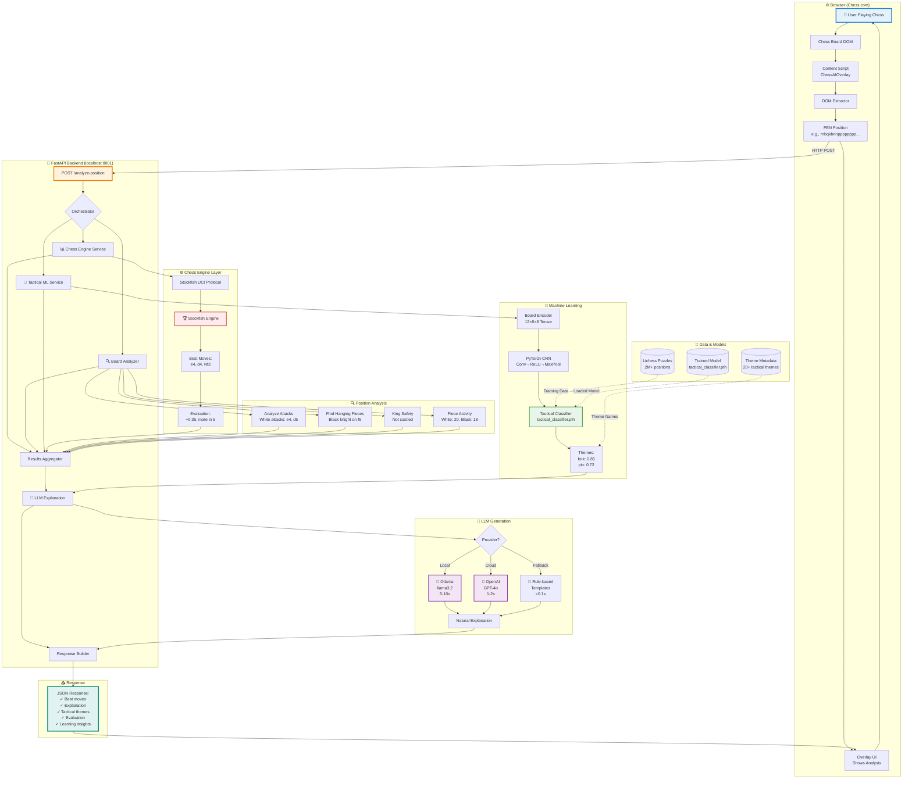
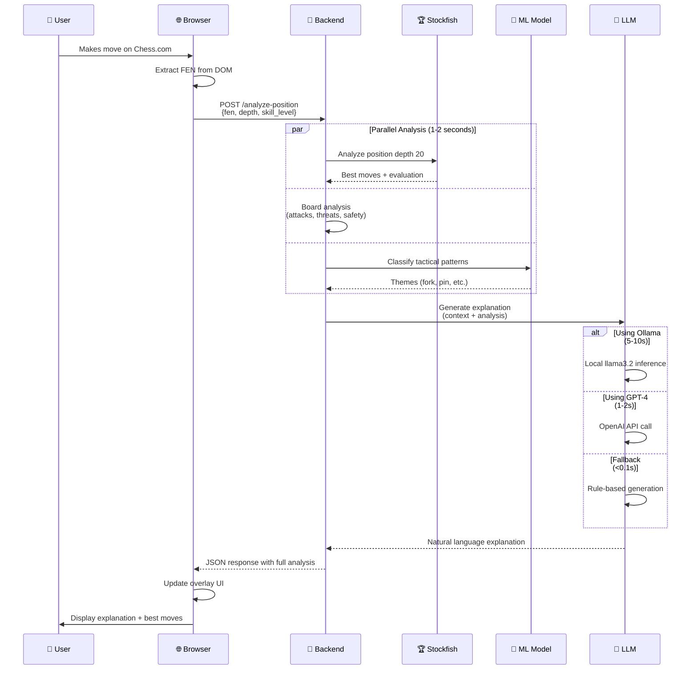
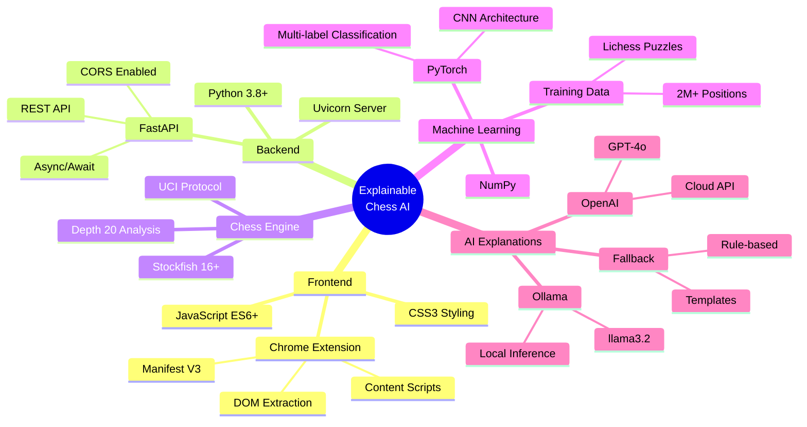
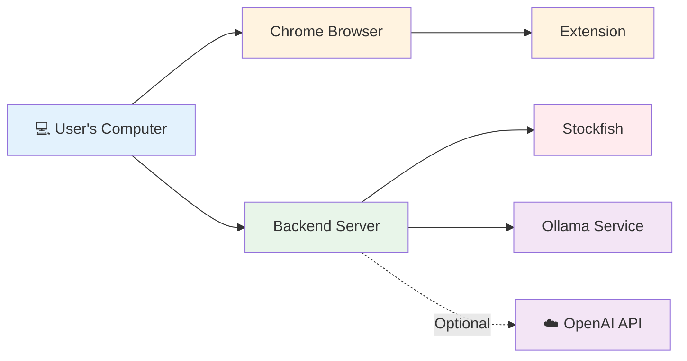

# Explainable Chess AI - Architecture Overview

## Complete System Flow



## Simplified Flow Diagram



## Data Flow Example

### Input (from browser)
```json
{
  "fen": "r1bqkb1r/pppp1ppp/2n2n2/4p3/2B1P3/5N2/PPPP1PPP/RNBQK2R w KQkq - 4 4",
  "depth": 20,
  "user_skill_level": "intermediate",
  "explanation_type": "comprehensive"
}
```

### Internal Processing

**Step 1: Stockfish Analysis**
```
Best move: d4 (evaluation: +0.45)
Alternative: O-O (evaluation: +0.32)
Alternative: d3 (evaluation: +0.28)
```

**Step 2: Board Analysis**
```
Attacks:
- White attacks: d5, e5, f7
- Black attacks: e4, d4
Hanging pieces: None
Threats: None
King safety: White not castled (score: 7/10)
Center control: White 5, Black 4
```

**Step 3: Tactical ML**
```
Detected themes:
- center_control: 0.89
- development: 0.76
- opening: 0.68
```

**Step 4: LLM Generation**
```
Prompt: "Explain why d4 is the best move in this opening position.
Move: d4 advances the pawn
Evaluation: +0.45
Themes: center_control, development"

Response: "d4 strengthens White's center control and opens lines 
for the dark-squared bishop. This move challenges Black's central 
pawn while maintaining development advantage."
```

### Output (to browser)
```json
{
  "fen": "r1bqkb1r/pppp1ppp/2n2n2/4p3/2B1P3/5N2/PPPP1PPP/RNBQK2R w KQkq - 4 4",
  "best_moves": [
    {
      "move": "d2d4",
      "san": "d4",
      "score": {"type": "cp", "value": 45, "display": "+0.45"}
    }
  ],
  "explanations": [
    {
      "explanation": "d4 strengthens White's center control and opens lines for the dark-squared bishop. This move challenges Black's central pawn while maintaining development advantage.",
      "skill_level": "intermediate",
      "confidence": 0.95
    }
  ],
  "position_evaluation": {
    "type": "cp",
    "value": 45,
    "display": "+0.45"
  },
  "tactical_motifs": ["center_control", "development"],
  "strategic_concepts": ["opening", "center_control", "development"],
  "learning_insights": [
    "Position type: opening",
    "Current turn: White",
    "Key concept: Central control is paramount in the opening phase"
  ],
  "analysis_time": 6.42
}
```

## Component Responsibilities

| Component | Responsibility | Input | Output | Time |
|-----------|---------------|-------|--------|------|
| **Content Script** | Extract board position | DOM elements | FEN string | <50ms |
| **Chess Engine** | Calculate best moves | FEN, depth | Moves + eval | 500-1000ms |
| **Board Analyzer** | Analyze tactical features | Board object | Attacks, threats | <100ms |
| **Tactical ML** | Detect patterns | Board tensor | Theme probabilities | 100-200ms |
| **LLM Service** | Generate explanation | All analysis | Natural text | 1-10s |
| **Overlay UI** | Display results | JSON response | Visual overlay | <50ms |

## Technology Summary



## Performance Profile

```mermaid
gantt
    title Analysis Timeline (Typical Request)
    dateFormat X
    axisFormat %L ms
    
    section Frontend
    Extract FEN           :0, 50
    Display Results       :6450, 50
    
    section Backend
    Parse Request         :50, 10
    Orchestrate Services  :60, 6390
    Build Response        :6440, 10
    
    section Chess Engine
    Stockfish Analysis    :60, 800
    
    section Board Analysis
    Tactical Analysis     :60, 100
    
    section ML Model
    CNN Inference         :60, 150
    
    section LLM
    Generate Explanation  :1000, 5000
```



**Bottleneck**: LLM generation (5-10s with Ollama, 1-2s with GPT-4)

**Optimization**: All non-LLM components run in parallel (~1s total)

## Deployment Model



**Note**: Everything runs locally except optional OpenAI API calls.

---

## Quick Reference

### Start System
```bash
# Terminal 1: Start Ollama (if using)
ollama serve

# Terminal 2: Start Backend
python simple_server.py

# Browser: Load extension
chrome://extensions/ → Load unpacked → frontend/
```

### Test Request
```bash
curl -X POST http://localhost:8001/analyze-position \
  -H "Content-Type: application/json" \
  -d '{"fen": "rnbqkbnr/pppppppp/8/8/4P3/8/PPPP1PPP/RNBQKBNR b KQkq e3 0 1"}'
```

### Key Files
- **Frontend Entry**: `frontend/content-scripts/content-script.js`
- **Backend Entry**: `backend/app/main.py` or `simple_server.py`
- **Chess Engine**: `backend/app/services/chess_engine.py`
- **ML Model**: `backend/models/saved_models/tactical_classifier.pth`
- **LLM Service**: `backend/app/services/llm_explanation.py`

---

*For detailed component documentation, see [ARCHITECTURE.md](ARCHITECTURE.md)*

