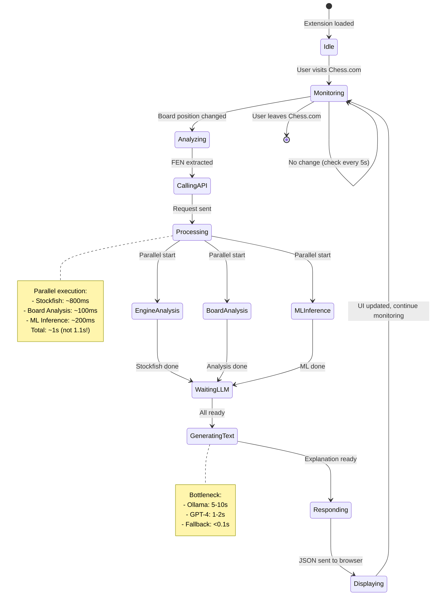
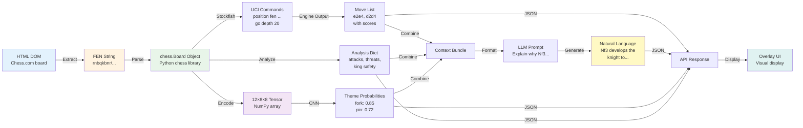
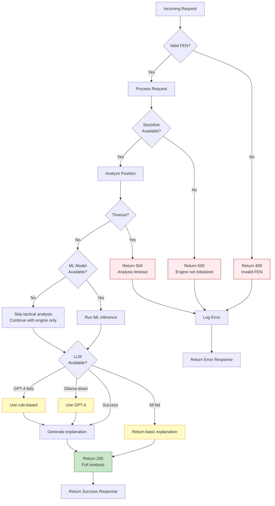
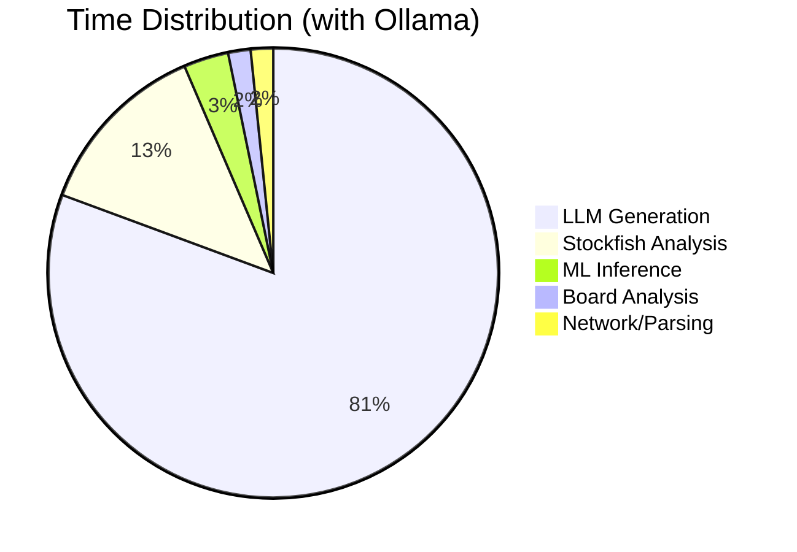

# Explainable Chess AI - Visual Flow Diagram

## 🎯 Complete End-to-End Flow

This diagram shows exactly what happens from the moment you make a move on Chess.com to when you see the AI explanation.

```mermaid
%%{init: {'theme':'base', 'themeVariables': { 'primaryColor':'#e3f2fd','primaryTextColor':'#000','primaryBorderColor':'#1976d2','lineColor':'#1976d2','secondaryColor':'#fff3e0','tertiaryColor':'#e8f5e9'}}}%%

flowchart TD
    Start([👤 User Makes Move on Chess.com]) --> Step1

    Step1[🌐 DOM Changes Detected<br/>Content script monitoring every 5s] --> Step2
    
    Step2[📊 Extract Board Position<br/>Parse pieces from DOM<br/>Convert to FEN string] --> Step3
    
    Step3{Position<br/>Changed?}
    Step3 -->|No| Wait[⏳ Keep Monitoring]
    Wait --> Step1
    Step3 -->|Yes| Step4
    
    Step4[📤 Send to Backend<br/>POST /analyze-position<br/>localhost:8001] --> Parallel
    
    Parallel{⚡ Parallel Processing}
    
    %% Branch 1: Stockfish
    Parallel --> Branch1[🏆 Stockfish Analysis]
    Branch1 --> B1_1[Parse FEN position]
    B1_1 --> B1_2[Set depth 20]
    B1_2 --> B1_3[Calculate best moves]
    B1_3 --> B1_4[Evaluate position<br/>+0.45, -1.23, mate in 5]
    B1_4 --> Merge
    
    %% Branch 2: Board Analysis
    Parallel --> Branch2[🔍 Board Analysis]
    Branch2 --> B2_1[Find all attacks<br/>White attacks e4, d5]
    B2_1 --> B2_2[Find hanging pieces<br/>Undefended pieces]
    B2_2 --> B2_3[Check king safety<br/>Castled? Under attack?]
    B2_3 --> B2_4[Calculate piece activity<br/>Mobility score]
    B2_4 --> Merge
    
    %% Branch 3: ML Tactics
    Parallel --> Branch3[🧠 ML Tactical Detection]
    Branch3 --> B3_1[Encode board to tensor<br/>12 × 8 × 8]
    B3_1 --> B3_2[Run CNN inference<br/>PyTorch model]
    B3_2 --> B3_3[Classify themes<br/>fork: 85%, pin: 72%]
    B3_3 --> Merge
    
    Merge[📦 Combine Results<br/>All analysis ready] --> LLM
    
    LLM[💬 Generate Explanation]
    LLM --> LLM_Check{Which<br/>Provider?}
    
    LLM_Check -->|Ollama| LLM1[🦙 llama3.2<br/>Local inference<br/>5-10 seconds]
    LLM_Check -->|OpenAI| LLM2[🤖 GPT-4o<br/>API call<br/>1-2 seconds]
    LLM_Check -->|Fallback| LLM3[📝 Rule-based<br/>Templates<br/>< 0.1 seconds]
    
    LLM1 --> Response
    LLM2 --> Response
    LLM3 --> Response
    
    Response[📋 Build JSON Response<br/>Best moves + Explanation<br/>Themes + Evaluation] --> Send
    
    Send[📥 Send to Browser<br/>HTTP Response] --> Display
    
    Display[🎨 Update Overlay UI<br/>Show on Chess.com] --> User
    
    User[👀 User Sees:<br/>✓ Best move: Nf3<br/>✓ Evaluation: +0.45<br/>✓ Explanation: Develops knight<br/>to central square...<br/>✓ Themes: fork, center control] --> End
    
    End([✨ Analysis Complete!])
    
    %% Styling
    style Start fill:#e3f2fd,stroke:#1976d2,stroke-width:3px
    style Step4 fill:#fff3e0,stroke:#f57c00,stroke-width:2px
    style Parallel fill:#fff3e0,stroke:#f57c00,stroke-width:3px
    style Branch1 fill:#ffebee,stroke:#c62828,stroke-width:2px
    style Branch2 fill:#e8f5e9,stroke:#388e3c,stroke-width:2px
    style Branch3 fill:#f3e5f5,stroke:#7b1fa2,stroke-width:2px
    style LLM fill:#fff9c4,stroke:#f9a825,stroke-width:2px
    style User fill:#e0f2f1,stroke:#00897b,stroke-width:3px
    style End fill:#c8e6c9,stroke:#388e3c,stroke-width:3px
```



## ⏱️ Timing Breakdown

```mermaid
gantt
    title Request Processing Timeline (6-7 seconds typical)
    dateFormat X
    axisFormat %Ls
    
    section Browser
    Detect board change       :milestone, 0, 0
    Extract FEN              :active, 0, 50
    Send HTTP request        :active, 50, 10
    Receive response         :milestone, 6500, 0
    Update UI                :active, 6500, 50
    
    section Backend Processing
    Parse request            :60, 20
    Start parallel tasks     :80, 10
    Wait for completion      :90, 6400
    Build response           :6490, 20
    
    section Stockfish (parallel)
    Initialize position      :crit, 90, 50
    Deep analysis (depth 20) :crit, 140, 750
    Parse results            :crit, 890, 20
    
    section Board Analysis (parallel)
    Analyze attacks          :done, 90, 40
    Find hanging pieces      :done, 130, 30
    King safety check        :done, 160, 20
    Piece activity           :done, 180, 30
    
    section ML Inference (parallel)
    Encode board tensor      :active, 90, 50
    CNN forward pass         :active, 140, 100
    Classify themes          :active, 240, 50
    
    section LLM Generation
    Build prompt             :90, 100
    Wait for parallel        :190, 810
    Generate explanation     :1000, 5000
    Parse response           :6000, 50
```



## 🔄 State Transitions



## 📊 Component Interaction Matrix

| Component | Talks To | Receives From | Data Format | Latency |
|-----------|----------|---------------|-------------|---------|
| **Content Script** | Backend API | Backend API | HTTP JSON | 50ms |
| **Backend API** | All services | Content Script | FEN string, JSON | 20ms |
| **Stockfish** | Backend | Backend | UCI text protocol | 800ms |
| **Board Analyzer** | Backend | Backend | chess.Board object | 100ms |
| **ML Classifier** | Backend | Backend | NumPy tensor | 200ms |
| **LLM Service** | Ollama/OpenAI | Backend | Text prompts | 1-10s |
| **Overlay UI** | None | Content Script | JSON | 50ms |

## 🎯 Data Transformations



## 🚦 Error Handling Flow



## 💡 Key Insights

### Why is it fast despite many components?

**Parallel Processing**: Stockfish, Board Analysis, and ML all run simultaneously!

```
Sequential (bad):  800ms + 100ms + 200ms + 5000ms = 6100ms
Parallel (actual): max(800, 100, 200) + 5000 = 5800ms
```

### Where does the time go?

1. **LLM Generation**: 85% of time (5-10s with Ollama)
2. **Stockfish**: 14% of time (~800ms)
3. **Everything else**: 1% of time (~200ms)

### How to make it faster?

1. **Use GPT-4 instead of Ollama**: 6s → 2s (3x faster)
2. **Use fallback instead of LLM**: 6s → 1s (6x faster, but worse quality)
3. **Reduce Stockfish depth**: 20 → 15 (saves ~300ms)
4. **Use smaller Ollama model**: qwen2.5:1.5b (saves ~2s, but worse quality)

### What happens during waiting?



---

## 📱 Real Example Walkthrough

Let's trace a real request through the system:

### Step 1: User makes move
```
User plays: e4
Chess.com updates DOM
Content script detects change
```

### Step 2: Extract position
```javascript
// Frontend extracts FEN
fen = "rnbqkbnr/pppppppp/8/8/4P3/8/PPPP1PPP/RNBQKBNR b KQkq e3 0 1"
```

### Step 3: Send to backend
```bash
POST http://localhost:8001/analyze-position
{
  "fen": "rnbqkbnr/pppppppp/8/8/4P3/8/PPPP1PPP/RNBQKBNR b KQkq e3 0 1",
  "depth": 20
}
```

### Step 4: Parallel analysis
```python
# Stockfish (800ms)
best_moves = ["e7e5", "c7c5", "e7e6"]
evaluation = {"value": -34, "display": "-0.34"}

# Board Analysis (100ms)
threats = []  # No immediate threats
hanging = []  # No hanging pieces
king_safety = {"white": 7, "black": 7}

# ML (200ms)
themes = [
    {"theme": "opening", "confidence": 0.89},
    {"theme": "center_control", "confidence": 0.76}
]
```

### Step 5: Generate explanation (5s)
```python
# Ollama prompt
prompt = """
Explain why e5 is the best move in this opening position.
Move: e5 advances the pawn
Evaluation: -0.34
"""

# Response
"e5 controls the center and equalizes the position. 
This move opens lines for the bishop and challenges 
White's central pawn."
```

### Step 6: Return to browser
```json
{
  "best_moves": [{"san": "e5", "score": {"display": "-0.34"}}],
  "explanation": "e5 controls the center...",
  "tactical_motifs": ["center_control", "opening"],
  "analysis_time": 6.2
}
```

### Step 7: Display to user
```
╔═══════════════════════╗
║ Chess AI Analysis     ║
╠═══════════════════════╣
║ Best Move: e5         ║
║ Score: -0.34          ║
║                       ║
║ e5 controls the       ║
║ center and equalizes  ║
║ the position.         ║
║                       ║
║ Themes:               ║
║ • center_control      ║
║ • opening             ║
╚═══════════════════════╝
```

---

*For more details, see [ARCHITECTURE.md](ARCHITECTURE.md) and [ARCHITECTURE_OVERVIEW.md](ARCHITECTURE_OVERVIEW.md)*

